# Arquitectura del sistema — Stream Media

Especificación de arquitectura del servicio de streaming auto-hospedado.
Describe **lo que está implementado**, no lo planeado. Las brechas conocidas
están en `TODO.md`; las invariantes, la deuda de rendimiento y la cobertura de
tests, en `REVIEW.md`.

Los diagramas son [Mermaid](https://mermaid.js.org/) embebido, que GitHub
renderiza sin build. Si algún día hace falta algo que Mermaid no da, la
convención es agregar un `.puml` en `docs/` y referenciarlo desde acá, no mezclar
los dos formatos en el mismo diagrama.

**Documentos relacionados:** `README.md` (puesta en marcha y lista de
endpoints). Los contratos de la API no se describen acá. Los
`.claude/Feature-*.md` son planes de trabajo de features ya hechas (HDR→SDR, ABM,
rediseño del frontend), no especificación: ante una contradicción, manda el
código.

---

## 1. Qué problema resuelve

Reproducir en el navegador una película que está en un disco de casa, sin
convertirla de antemano y sin perder las pistas de audio ni los subtítulos que
trae.

Las tres restricciones que dan forma a todo lo demás:

1. **El navegador no reproduce MKV**, ni H.265, ni DTS, ni HDR de forma
   confiable. Hay que reempaquetar y, a veces, recodificar.
2. **Recodificar es caro**: minutos para un remux, horas para AV1. No se puede
   hacer sincrónicamente dentro de una request.
3. **Cambiar de idioma no puede cortar la reproducción.** Esto es lo que
   descarta el diseño obvio (audio multiplexado en el video) y obliga al de
   pistas separadas.

### Atributos de calidad priorizados

| Atributo | Cómo se persigue | Qué se sacrificó |
|---|---|---|
| Time-to-first-frame | Playlist EVENT mientras se construye; se reproduce apenas hay dos segmentos en disco | Complejidad: dos formatos de playlist |
| Costo de reapertura | Cache persistente indexado por `(ruta, mtime, tamaño)` | Disco: hasta `Cache:MaxBytes` |
| Cambio de idioma instantáneo | Renditions de audio separadas del video | Un proceso FFmpeg por pista |
| Simplicidad operativa | Un contenedor, un proceso, sin cola de trabajos ni broker | Sin escalado horizontal |

---

## 2. Vista de contexto

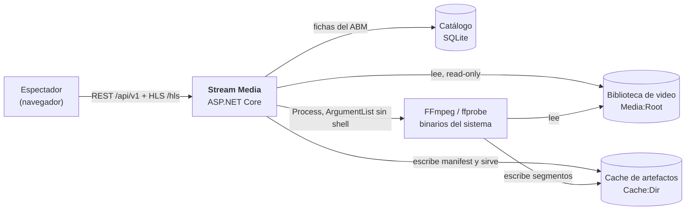

Dos cosas que este diagrama tiene que dejar claras:

- **FFmpeg escribe directo en el cache.** El servidor no transforma bytes de
  video: le da a FFmpeg un directorio de salida y después sirve esos archivos
  tal cual (`PhysicalFile`, con soporte de rangos).
- **El origen se lee, nunca se escribe.** El montaje es `:ro` en Compose, y esa
  es una garantía de despliegue, no una convención del código.

---

## 3. Vista de contenedores

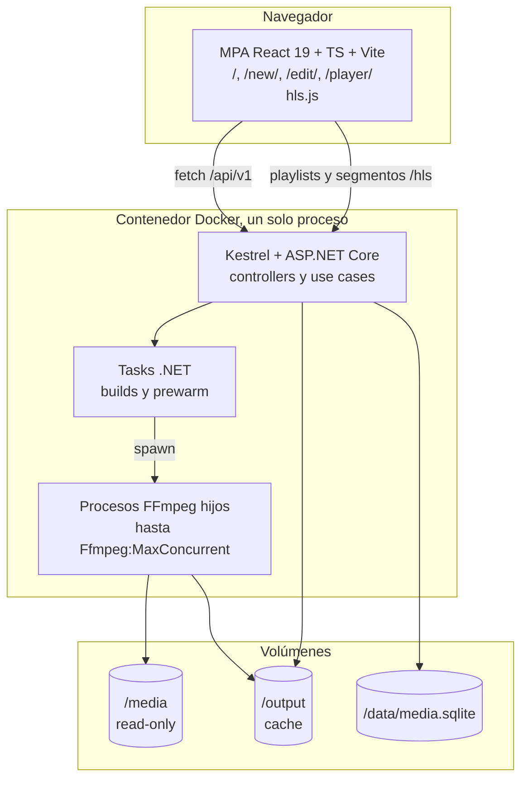

**Es un solo proceso.** No hay worker aparte, ni Redis, ni cola. Los builds son
`Task`s en el mismo proceso que atiende las requests, coordinadas por dos
niveles de `SemaphoreSlim` en `AssetBuilder` (§7). Es una decisión deliberada de
homelab, y es también de donde salen sus límites (`TODO.md`).

El frontend compilado vive en `wwwroot` y lo sirve el mismo Kestrel. No hay
servidor de frontend en producción.

---

## 4. Vista de componentes

Cuatro proyectos. Las flechas son referencias de proyecto: Application solo
conoce Domain; Infrastructure implementa las interfaces que declara Application.

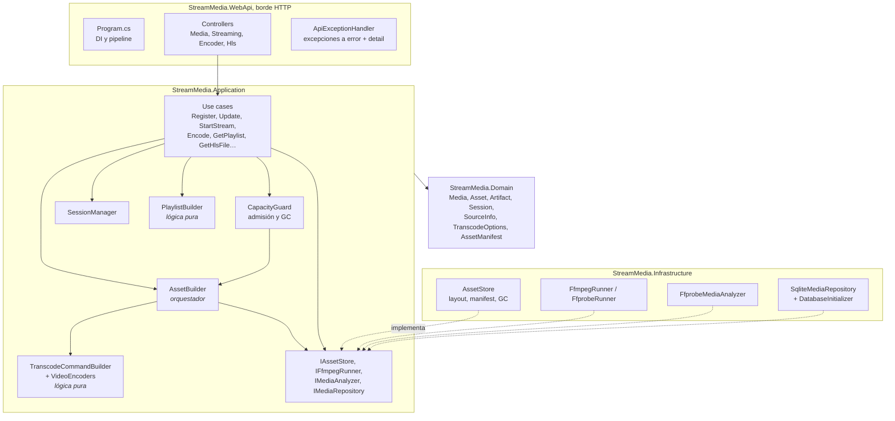

### Responsabilidades

| Componente | Es dueño de | No sabe nada de |
|---|---|---|
| `AssetBuilder` | El ciclo de vida del asset en memoria: abrir, decidir qué falta, lanzar y supervisar builds, guardar el manifest | HTTP, la base de datos, las fichas |
| `CapacityGuard` | Admitir o rechazar una apertura nueva y correr el GC | Cómo se construye un asset |
| `AssetStore` | La identidad del asset, el layout en disco, el `manifest.json`, el uso de espacio y el borrado | FFmpeg, playlists |
| `TranscodeCommandBuilder` / `VideoEncoders` | Los argumentos de FFmpeg | Qué asset es, por qué se lo llama |
| `FfmpegRunner` | El proceso: drenar stdout/stderr, progreso, matarlo al cancelar | Qué está codificando |
| `PlaylistBuilder` | Producir los `.m3u8` a partir de duraciones y nombres | Disco, FFmpeg, red |
| `FfprobeMediaAnalyzer` | Interpretar ffprobe y modelar el origen (`SourceInfo`) | Cache, sesiones |
| `SessionManager` | Quién está mirando y desde cuándo, solo en memoria | Archivos, builds |
| Use cases de `Media/` | El catálogo editorial | El cache HLS (salvo disparar el prewarm) |

**La dependencia que no existe** es tan importante como las que sí:
`AssetBuilder` **no conoce la base de datos**. Su `SourceInfo` sale del manifest
del cache o de un ffprobe nuevo. Por eso la selección de pistas viaja como un
`IgnoredTracks` (dos conjuntos de índices) desde el use case, que es el único
que tiene la ficha en la mano.

`PlaylistBuilder`, `TranscodeCommandBuilder` y `VideoEncoders` son lógica pura:
entran datos y salen strings o listas de argumentos. No tocan disco ni red, y
por eso son, junto con `SessionManager`, lo único que hoy tiene tests (§10).

### El registro de encoders

`VideoEncoders` (`Encoder/VideoEncoder.cs`) es un diccionario `nombre → VideoEncoder`.
Cada encoder aporta solo lo propio: sus argumentos de codec, su filtro de escala
para un alto máximo, el string de `CODECS` que anuncia (o `null`) y su `pix_fmt`.
Lo común lo arma `VideoEncoder.BuildArgs` para todos: un único `-vf` con escala →
tonemap HDR→SDR (si corresponde) → etiquetado BT.709, y `-force_key_frames` en
cada borde de segmento.

| Encoder | Cuándo | Parámetros | `CODECS` |
|---|---|---|---|
| `h264` | Streaming (default de `new TranscodeOptions()`) | libx264 preset `slower`, CRF 21, high@3.1, caja 1280×720 que respeta el DAR y no agranda, `setsar=1` | `avc1.64001f` fijo, coincide con `-level:v 3.1` |
| `av1` | Perfil `TranscodeProfiles.Archive` | SVT-AV1 preset 6, CRF 24, 10 bits, alto máximo 1080, transcode forzado | `null`: se omite el atributo (I4 en `REVIEW.md`) |

El etiquetado de color va como filtro `setparams` y no como `-color_primaries`
y compañía: según el código, FFmpeg toma el color de los frames e ignora esas
opciones. Si el tonemap se aplica o no lo decide `AssetBuilder` según la fuente
(`SourceInfo.IsHdr()`, a partir de `ColorTransfer`), nunca el perfil.

---

## 5. Vista de datos

### 5.1 Modelo de dominio

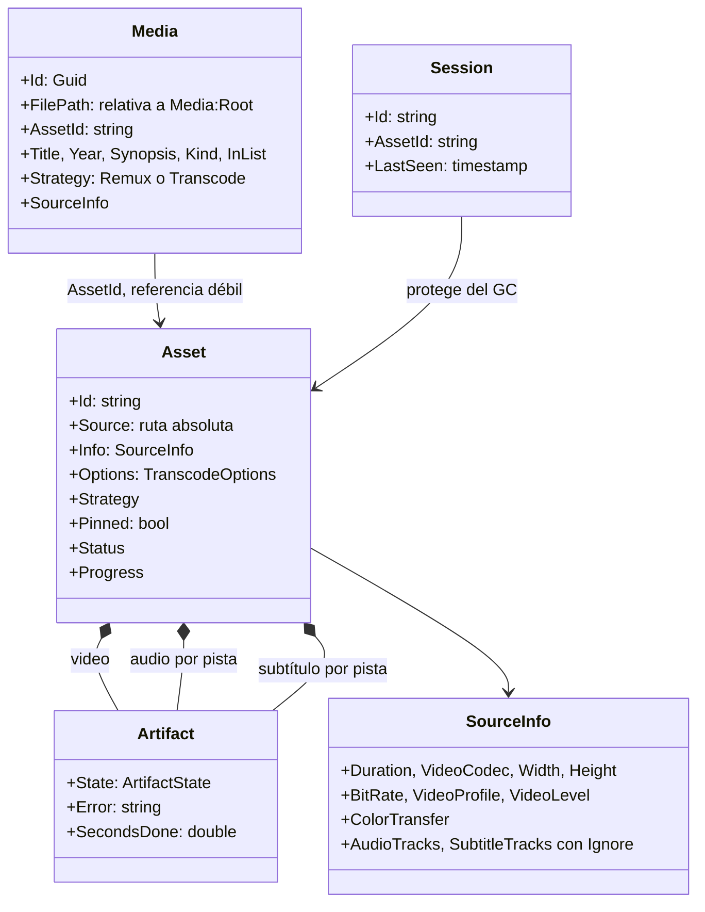

**`Media` ↔ `Asset` es una relación débil a propósito.** La ficha guarda un
`AssetId` calculado en el alta, pero el asset puede no existir todavía o haber
sido borrado por el GC, y nada valida esa referencia. `/stream` y `/encode`
recalculan el id de la terna `(ruta, mtime, tamaño)` cada vez, así que siempre
coincide mientras el archivo no cambie, y si cambia *debe* dejar de coincidir.
La excepción es el `GET` del encode, que usa el guardado (`TODO.md` #12).

**La estrategia** (`Remux` o `Transcode`) se deriva del codec en el alta (solo
H.264 se reempaqueta) y el usuario la puede cambiar en el `PATCH`; pedir remux
para un codec que no es H.264 se rechaza. El asset la toma de la ficha con el
cache frío y del manifest con el cache caliente. Una fuente HDR nunca se copia,
aunque la estrategia sea remux: el tonemap exige recodificar.

`Asset.Status` es `failed` solo si falló el video, `ready` cuando el video y
todos los audios están listos (los subtítulos no cuentan), y `processing` en
otro caso. *Reproducible* es otra cosa y la calcula `AssetPlayability` en
Application (el dominio no toca disco): video listo, o al menos dos segmentos
de video en disco.

### 5.2 Los tres ciclos de vida

Es el concepto que más confusión causa y conviene fijarlo:

| | `Media` (ficha) | `Asset` (artefactos) | `Session` (espectador) |
|---|---|---|---|
| **Dónde vive** | SQLite | Disco + memoria | Solo memoria |
| **Identidad** | GUID | `sha256(ruta\|mtime\|tamaño)`, 16 hex | 12 hex de un GUID |
| **Sobrevive al reinicio** | Sí | Sí, vía el manifest | No |
| **Quién lo borra** | Nadie: no hay endpoint de borrado | El GC por LRU | `Prune`, tras 12 min sin heartbeat |
| **Es dueño de archivos** | No | Sí | No |

Una `Session` **no es dueña de nada**: lo único que hace es proteger a su asset
del GC.

### 5.3 Layout en disco

```
{Cache:Dir}/{asset_id}/
├── manifest.json               ← lo que sobrevive al reinicio
├── .last-access                ← segundos Unix: el orden del LRU
├── video/
│   ├── init.mp4                ← init segment CMAF
│   ├── seg-00000.m4s …         ← segmentos, sin audio (-an)
│   └── internal.m3u8           ← de FFmpeg; NUNCA se sirve
├── audio/{n}/                  ← n = índice entre las pistas de audio (0:a:n)
│   ├── init.mp4
│   ├── seg-00000.m4s …         ← sin video (-vn)
│   └── internal.m3u8
└── subs/sub_{n}_{lang}.vtt     ← estáticos, fuera del pipeline HLS
```

La base va en `Database:Path` (`/data/media.sqlite` en Compose), **fuera del
cache**: ahí manda el GC por tamaño.

### 5.4 El manifest

`manifest.json` es **la única fuente de verdad que cruza reinicios**. Lo escribe
`AssetBuilder` en cada apertura y cada vez que termina un artefacto, de forma
atómica (temporal + rename) y serializado por el lock del asset. Las claves son
snake_case y los enums en minúscula, las mismas del prototipo.

```json
{
  "asset_id": "…",
  "source": "/media/…",
  "duration": 7412.3,
  "strategy": "remux",
  "video": "ready",
  "audio": {"0": "ready", "1": "building"},
  "subtitles": {"0": "sub_0_spa.vtt"},
  "subtitles_failed": [2],
  "info":    { "SourceInfo, incluidos los flags ignore": "…" },
  "options": { "TranscodeOptions con las que se construyó": "…" },
  "pinned": false
}
```

Dos campos merecen justificación, porque se los borraría por parecer
redundantes:

- **`options`**: describe *los segmentos que hay en disco*, no la configuración
  del servidor. Sin esto, un asset generado en AV1 y reabierto con el default
  H.264 se anunciaría como `avc1.64001f` y el player abriría el SourceBuffer
  con un codec que no es el de los segmentos. `LoadAsync` las rehidrata de acá;
  un manifest sin el bloque cae en el default del servidor.
- **`subtitles_failed`**: PGS y VobSub son bitmap y **nunca** van a extraerse a
  WebVTT. Sin recordar el fracaso, cada apertura reintenta leer el archivo
  entero.

Un matiz que importa: para **video y audio**, el estado que manda al recargar
es el del disco, no el del manifest. `LoadAsync` los marca `ready` solo si el
`internal.m3u8` tiene `#EXT-X-ENDLIST`, y si no los deja en `pending` para
rehacerlos de cero. Los que confían en el campo `video` del manifest sin cargar
el asset son los use cases de encode (`TODO.md` #5).

Un manifest anterior a `ColorTransfer` con el video sin construir dispara un
ffprobe nuevo solo para ese dato: sin él no se puede decidir el tonemap.

---

## 6. Vistas dinámicas

### 6.1 Alta de una ficha

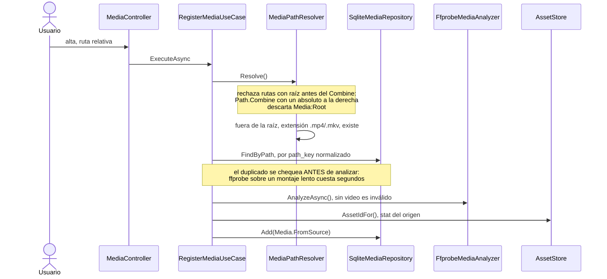

**El alta no codifica nada.** Eso es lo que permite que un `PATCH` alcance para
elegir pistas: entre el alta y el `PATCH` no hay trabajo que cancelar ni
artefactos que borrar.

### 6.2 Edición de la ficha y prewarm

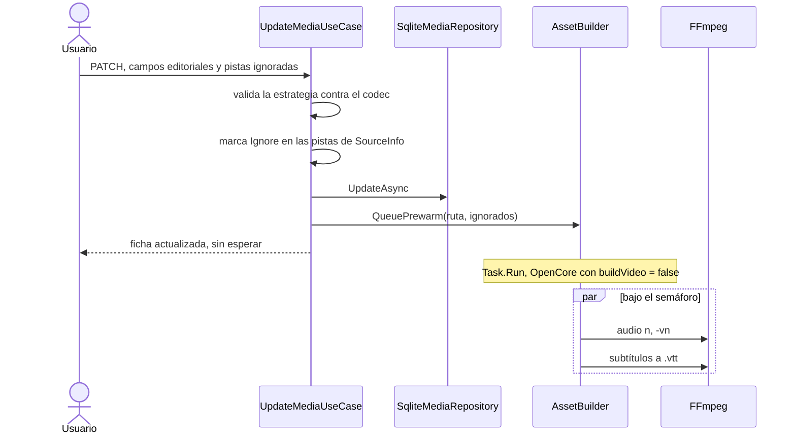

Todo `PATCH` encola un prewarm: el audio y los subtítulos de la selección
nueva, **nunca el video**. Es idempotente: lo que ya está listo no se rehace.
El video queda en `pending`, así que `/stream` o `/encode` todavía pueden elegir
con qué opciones construirlo (I7 en `REVIEW.md`). El prewarm **no pasa por
`CapacityGuard`** (`TODO.md` #10), y deseleccionar una pista no cancela su build
en curso (`TODO.md` #20).

### 6.3 Reproducir

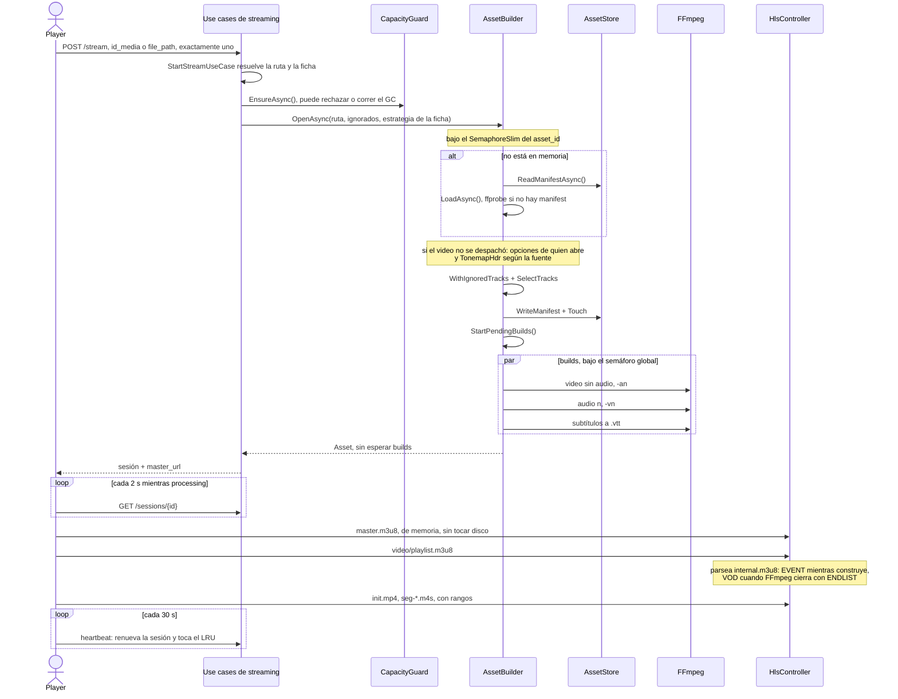

Lo que **no** pasa acá es igual de significativo: `OpenAsync` no espera a
ningún build, y la respuesta sale en milisegundos aunque falten horas de
transcodificación.

Si la playlist pedida todavía no tiene `internal.m3u8`, la respuesta es un 503
con `Retry-After` y no un 404: hls.js deja de pedir ante un 404 y reintenta
ante un 503.

### 6.4 Cambiar de idioma o de subtítulo: sin servidor

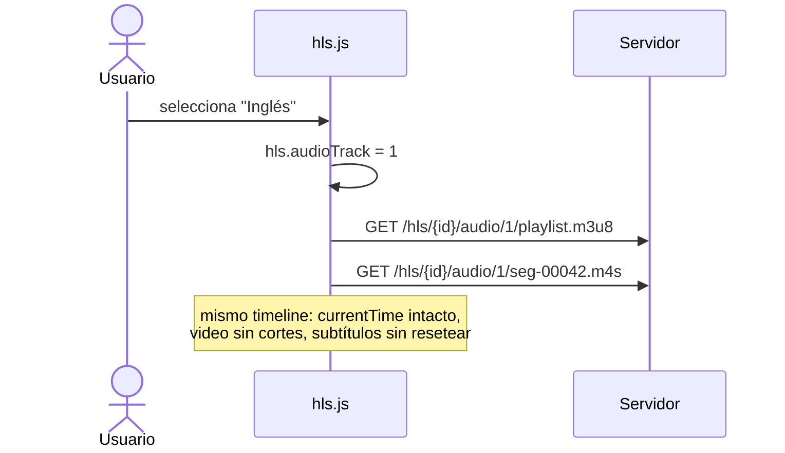

**No hay endpoint para esto y no lo va a haber**, igual que no lo hay para seek.
El master declara las renditions con `#EXT-X-MEDIA:TYPE=AUDIO` y el resto lo
resuelve el cliente. Los subtítulos tampoco pasan por HLS: el player los carga
como `<track>` con la URL del `.vtt`. Si aparece una ruta de "cambiar pista",
algo se rompió conceptualmente.

### 6.5 Codificación de biblioteca

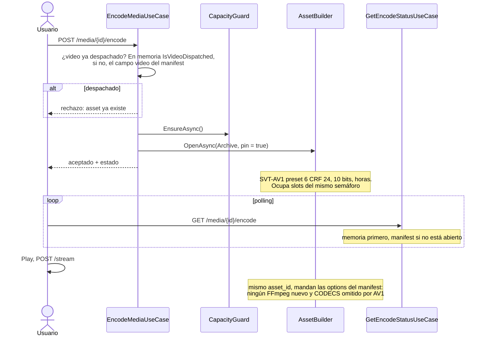

Los dos disparadores, `/stream` y `/encode`, alimentan **el mismo pipeline** y
producen **el mismo asset**. Lo único que cambia es el perfil y el `pin`. El
audio y los subtítulos que dejó el prewarm no se rehacen.

### 6.6 Estados de un artefacto

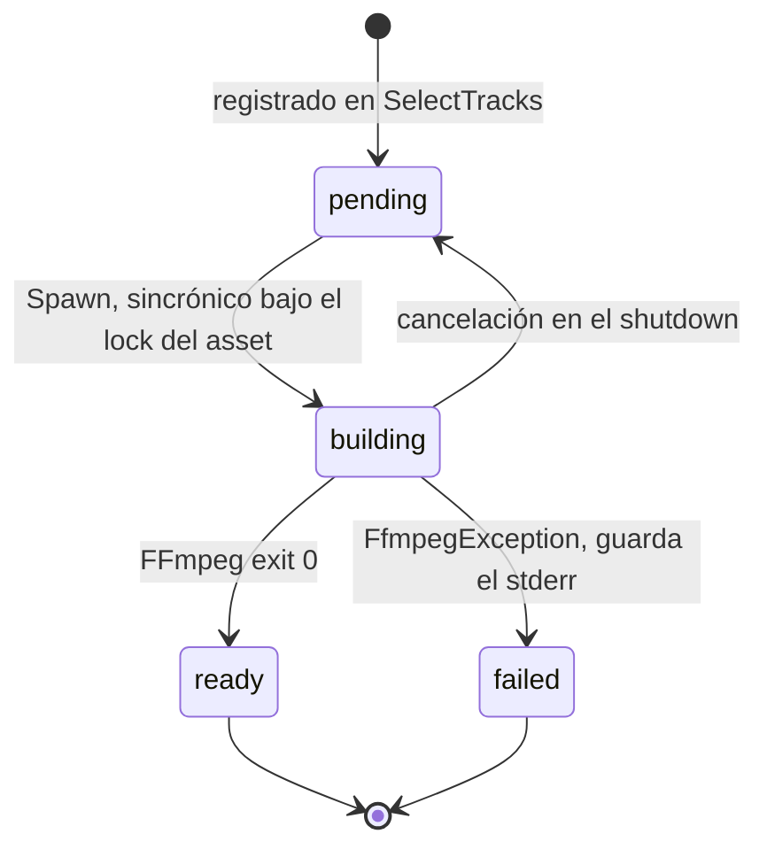

`building` se marca **antes** de conseguir un slot del semáforo: incluye la
espera en cola. Es lo que evita un doble lanzamiento (otra apertura ya ve
`building`), y es también lo que cuenta `CapacityGuard` (`TODO.md` #10).

**Un artefacto que falla no arrastra a los demás.** Si se cae una pista de
audio, el video y los otros idiomas se siguen sirviendo.

### 6.7 Recolección de espacio, bajo demanda

No hay ciclo de limpieza periódico. El GC corre dentro de `CapacityGuard.EnsureAsync`,
y solo cuando la apertura pedida generaría trabajo nuevo.

```mermaid
sequenceDiagram
    participant G as CapacityGuard
    participant B as AssetBuilder
    participant SM as SessionManager
    participant S as AssetStore

    alt asset en memoria o con manifest
        Note over G: pasa sin chequear nada
    end
    G->>B: BuildingCount() contra MaxConcurrent
    G->>SM: Prune(), saca las sesiones vencidas
    G->>SM: ReferencedAssetIds()
    G->>B: BuildingAssetIds()
    G->>S: CollectAsync(MaxBytes, keep = unión)
    Note over S: tamaño total; si sobra, candidatos sin keep<br/>ni pin, por .last-access ascendente, borra hasta bajar
    S-->>G: asset_ids borrados
    G->>B: Forget(id) por cada uno
    G->>S: TotalBytesAsync(), si sigue lleno rechaza
```

Una sesión protege su asset mientras existe; `Prune` saca las que llevan 12
minutos sin heartbeat (una vencida ya no se lee ni se renueva) y su asset pasa a
ser candidato.

El `Forget` no es opcional: sin él se seguirían sirviendo playlists que apuntan
a segmentos que ya no existen. El pin se chequea **dentro** de `CollectAsync` y
no en el `keep` del que llama: olvidarlo en un solo llamador alcanzaría para
perder horas de codificación.

---

## 7. Vista de concurrencia

No hay event loop único: Kestrel atiende las requests en el thread pool, y los
builds son `Task`s que corren en el mismo pool. Un llamado bloqueante ocupa un
hilo, no detiene el servidor.

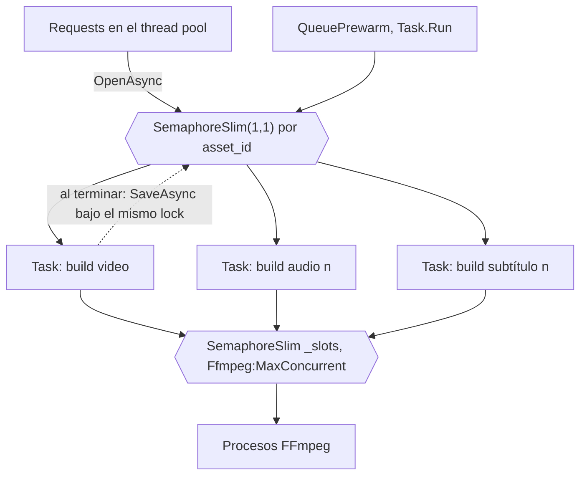

### Mecanismos

| Mecanismo | Dónde | Qué garantiza |
|---|---|---|
| `SemaphoreSlim(1,1)` por `asset_id` | `AssetBuilder.OpenCoreAsync` y `SaveAsync` | Dos aperturas simultáneas de la misma película no lanzan dos FFmpeg; dos builds que terminan a la vez no pisan el manifest |
| `SemaphoreSlim _slots` (default 2) | `AssetBuilder.RunAsync` | Nunca más de N FFmpeg vivos, sin importar de cuántos assets |
| `ConcurrentDictionary` de tareas | `Spawn`, `QueuePrewarm` | `DisposeAsync` espera a todas en el shutdown |
| `CancellationTokenSource _shutdown` | `AssetBuilder` → `FfmpegRunner` | Al apagar se mata el árbol de procesos y el artefacto vuelve a `pending` |
| Escritura temporal + rename | `AssetStore.WriteManifestAsync` | Ninguna lectura ve un JSON a medio escribir |
| Estado mutado in-place | `Artifact` | El polling de `/sessions/{id}` ve el avance sin tocar disco |

**Prioridad de los builds:** video primero, después audio, después subtítulos.
`StartPendingBuilds` los lanza en ese orden y cada uno llega al `WaitAsync` del
semáforo sincrónicamente, así que en la práctica se atienden en ese orden. El
video es lo único que el usuario está esperando para poder mirar algo; el audio
termina mucho antes de todos modos.

**Sin lock de admisión.** `CapacityGuard` chequea y después abre sin
atomicidad. El código lo reconoce: con pocos usuarios el hueco es improbable.

Lo que sigue siendo sincrónico (recorrido del cache, disco en caminos
calientes, SQLite) está en `REVIEW.md` §2.

---

## 8. Vista de despliegue

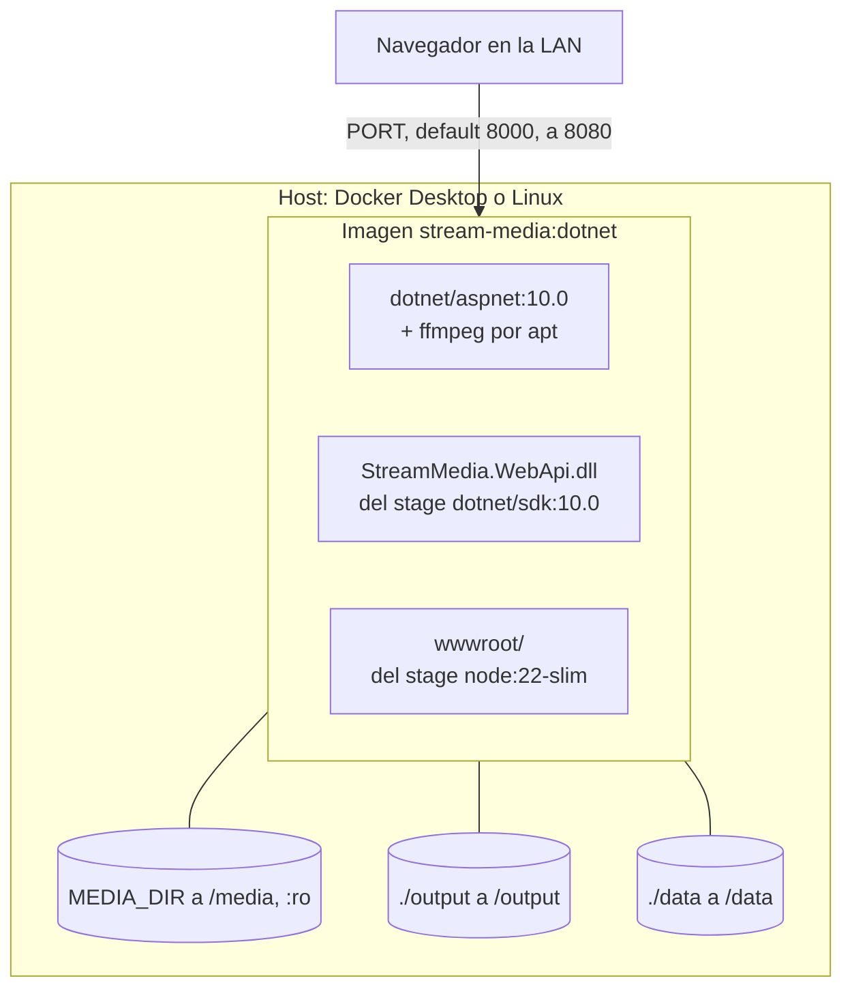

La imagen es **multi-stage** en tres pasos: `node:22-slim` compila el frontend,
`dotnet/sdk:10.0` publica la API y la imagen final es `dotnet/aspnet:10.0` con
ffmpeg instalado por apt (versión no fijada: la de la distro de la imagen). La
imagen final no lleva Node ni el SDK. Compose usa `init: true` para que los
procesos FFmpeg hijos reciban las señales y no queden zombis.

**Costo medido del bind mount.** En Docker Desktop sobre Windows, escribir los
segmentos en el bind mount `./output` resultó ~48% más lento que en el disco
del contenedor (A/B de 94 segmentos, `-c:v copy`). Es la traducción de sistema
de archivos de Docker Desktop, no el código: mover el cache a un volumen de
Docker lo evita.

### Configuración

Secciones de configuración de ASP.NET (`appsettings.json` + variables de
entorno con `__`). El `docker-compose.yml` las arma a partir de variables
`SM_*` del `.env`.

| Clave | Variable en Compose | Default | Efecto arquitectónico |
|---|---|---|---|
| `Media:Root` | `SM_MEDIA_ROOT` | ninguno (`/media` en Compose) | Ancla de todas las rutas. Sin ella, o si no existe, **la app no arranca** |
| `Cache:Dir` | `SM_CACHE_DIR` | `output` (`/output` en Compose) | Raíz del cache persistente; relativo al directorio de trabajo |
| `Cache:MaxBytes` | `SM_CACHE_MAX_BYTES` | 50 GiB | Umbral del LRU y del rechazo por espacio |
| `Database:Path` | `SM_DB_PATH` | `data/media.sqlite` (`/data/media.sqlite` en Compose) | **Fuera del cache**: ahí manda el GC por tamaño |
| `Ffmpeg:MaxConcurrent` | `SM_MAX_CONCURRENT_FFMPEG` | 2 | Tamaño del semáforo y único control de admisión de carga |

**No es configurable** el perfil de codificación de streaming: el codec, la
duración de segmento (`HlsTime` = 6 s), el CRF y la caja salen de
`new TranscodeOptions()` en `Program.cs`. El perfil de biblioteca es
`TranscodeProfiles.Archive`, también en código.

---

## 9. Espacio de URLs

`WebApplication` agrega `UseRouting` implícito al principio: **el endpoint se
elige antes de que corra cualquier middleware**, y eso cambia qué sirve qué.

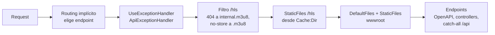

Los dos `UseStaticFiles` **se saltean si el routing ya eligió un endpoint**.
Como `HlsController` tiene rutas para `video/{file}`, `audio/{n}/{file}` y
`subs/{file}`, los segmentos, los `init.mp4` y los `.vtt` los sirve el
controller (vía `GetHlsFileUseCase` y `PhysicalFile` con rangos), no el
middleware de estáticos, que solo sirve lo que no tiene ruta (consecuencias en
`TODO.md` #8).

Reglas que importan hoy:

1. **`internal.m3u8` no sale nunca**, con tres cerrojos independientes: el
   filtro de `/hls` responde 404, `GetHlsFileUseCase` solo entrega `.mp4`,
   `.m4s` y `.vtt`, y las playlists que ve el cliente son rutas del controller
   que se calculan (no existe ningún `master.m3u8` ni `playlist.m3u8` en disco).
2. **Nombres simples.** `GetHlsFileUseCase` rechaza `asset_id` y nombres de
   archivo que no sean un nombre plano (sin separadores ni `..`): el path
   traversal se cierra sin depender de cómo parsee el router.
3. **El catch-all `/api/{**rest}` tiene la menor precedencia** y responde 404
   con el formato `{error, detail}` del proyecto. Cubre también un método que no
   existe sobre una ruta que sí (un `DELETE /api/v1/media/{id}` cae ahí).
4. **Agregar una ruta mueve quién sirve.** Una ruta nueva que matchee archivos
   del cache le saca esos archivos al middleware de estáticos, con sus
   cabeceras de cache.
5. **Las páginas del frontend son archivos.** `UseDefaultFiles` resuelve `/new/`
   a `new/index.html`; no hay fallback a un `index.html` global, así que una ruta
   inexistente da 404 como cualquier archivo. `/assets/*` (con hash de Vite) va
   `immutable`; el resto, `no-cache`.

---

## 10. Estrategia de pruebas

xUnit, un proyecto de tests por proyecto de `src/`.

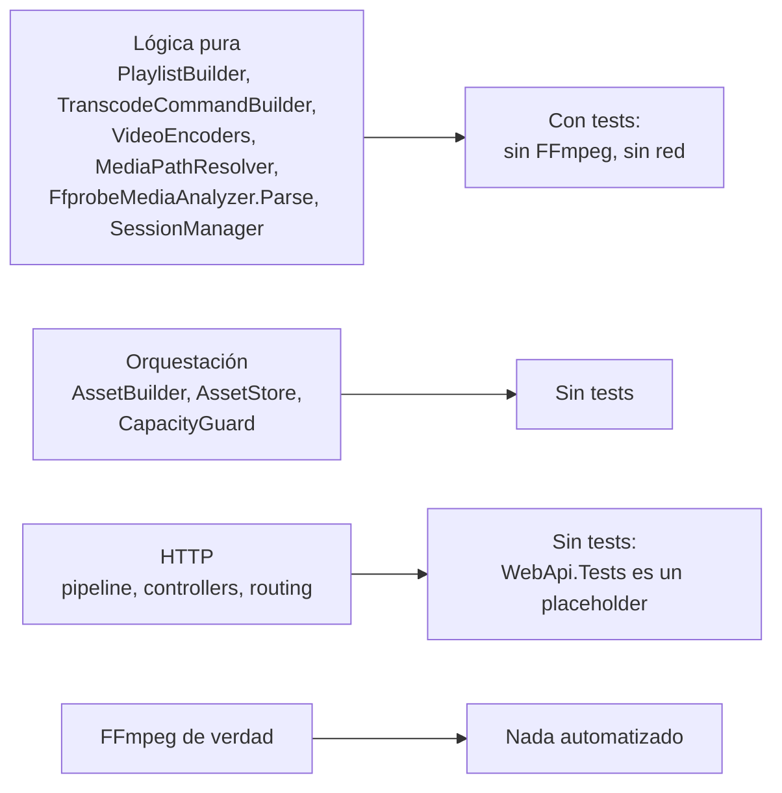

El detalle de qué tiene tests y qué falta está en `REVIEW.md` §3. El diseño
permite probar la orquestación sin binarios: `IFfmpegRunner`, `IMediaAnalyzer`
e `IAssetStore` son interfaces, y `SessionManager` y `AssetStore` reciben un
`TimeProvider`.

---

## 11. Bitácora de decisiones

| # | Decisión | Alternativa descartada | Por qué |
|---|---|---|---|
| D1 | Audio separado del video como rendition group | Audio multiplexado; reiniciar FFmpeg al cambiar de idioma | Cambiar de idioma dejó de cortar el video y de perder `currentTime` |
| D2 | Playlists calculadas en cada request | Servir el `.m3u8` que escribe FFmpeg | Con `hls_playlist_type vod` no hay duraciones hasta el final del build |
| D3 | Segmentos fMP4/CMAF | MPEG-TS | Requisito para audio separado y para AV1 |
| D4 | Identidad `(ruta, mtime, tamaño)` | Hash del contenido | Hashear varios GB en cada apertura; el mtime alcanza para invalidar |
| D5 | Cache persistente con LRU | Temporal que se borra al arrancar | Reabrir una película ya procesada no debería costar nada |
| D6 | Todas las pistas de audio seleccionadas, de entrada | Generarlas bajo demanda | El audio solo corre muy rápido y termina antes que el video |
| D7 | El encode de biblioteca usa el semáforo común | Una cola de trabajos aparte | Es un homelab: no hay CPU para dos colas |
| D8 | Encoders en un registro (`VideoEncoders`), con lo común en `BuildArgs` | Encoder hardcodeado en el builder de comandos | Agregar un encoder es agregar una entrada; hereda keyframes, tonemap y etiquetado sin tocar `AssetBuilder` |
| D9 | Un solo proceso, sin broker | Un worker aparte con cola | La carga real es un espectador y un par de FFmpeg |
| D10 | Subtítulos como `.vtt` estáticos cargados con `<track>` | Segmentados como rendition WebVTT | Sus tiempos ya son absolutos; segmentarlos no aporta nada |
| D11 | Backend en .NET 10 en cuatro proyectos (Domain, Application, Infrastructure, WebApi) | Seguir con el prototipo FastAPI | Application no conoce SQLite ni procesos: la orquestación queda detrás de interfaces y se puede probar sin binarios |
| D12 | Frontend MPA: un `index.html` por página | SPA con fallback al `index.html` | Cada página es un archivo: sobrevive un refresh sin reescritura de rutas, y una ruta inexistente da 404 igual en desarrollo que en producción |
| D13 | HDR siempre a SDR, decidido por la fuente en `AssetBuilder` | Tonemap como opción del perfil | Ningún perfil ni encoder nuevo puede olvidarse de convertir |
| D14 | Etiquetas BT.709 con el filtro `setparams` | `-color_primaries`, `-color_trc`, `-colorspace` | FFmpeg toma el color de los frames e ignora esas opciones |
| D15 | Prewarm de audio y subtítulos en el `PATCH` | Generar todo recién al reproducir | Cuando se toca Play o se lanza el encode solo falta el video |
| D16 | GC bajo demanda en la admisión | Un ciclo de limpieza periódico, como el prototipo | No hace falta un servicio en segundo plano. El costo: el vencimiento de sesiones se quedó sin disparador (L1) |
